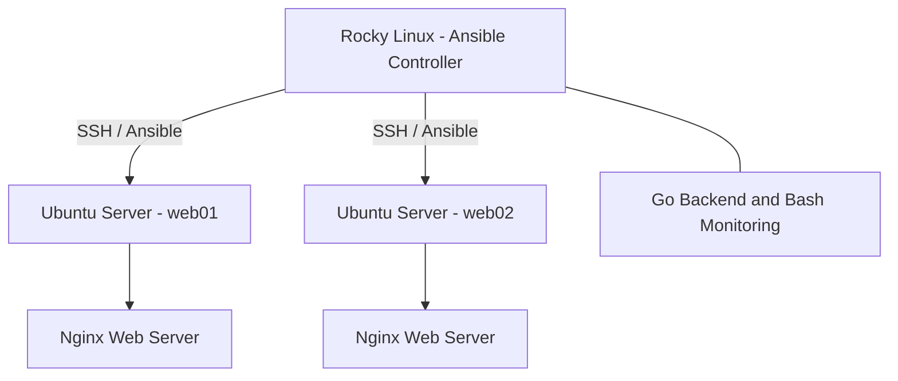

# Linux Server Management & Monitoring System

A personal infrastructure engineering project built to practice Linux server administration, configuration management, automation, and backend development.

## Project Overview

This project uses a Rocky Linux control server to manage two Ubuntu Server virtual machines through Ansible.

The environment includes Nginx web servers, Bash monitoring scripts, and a Go-based backend.

The goal is to gain practical experience managing Linux infrastructure, automating repetitive administration tasks, and developing monitoring functionality.

## Technologies Used

- **Operating Systems:** Rocky Linux, Ubuntu Server
- **Configuration Management:** Ansible
- **Web Server:** Nginx
- **Backend Development:** Go
- **Scripting:** Bash
- **Networking:** SSH, TCP/IP
- **Virtualization:** Oracle VirtualBox
- **Version Control:** Git and GitHub

## System Architecture

  
