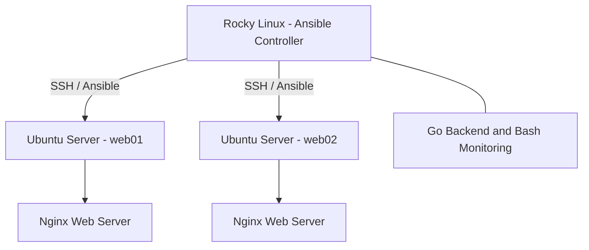

# Linux Server Management & Monitoring System

A personal infrastructure engineering project built to practice Linux server administration, configuration management, automation, and backend development.

## Project Overview

This project uses a Rocky Linux control server to manage two Ubuntu Server virtual machines through Ansible.

The environment includes Nginx web servers, Bash monitoring scripts, and a Go-based backend.

The goal is to gain practical experience managing Linux infrastructure, automating repetitive administration tasks, and developing monitoring functionality.

## Technologies Used

- **Operating Systems:** Rocky Linux, Ubuntu Server
- **Configuration Management:** Ansible
- **Web Server:** Nginx
- **Backend Development:** Go
- **Scripting:** Bash
- **Networking:** SSH, TCP/IP
- **Virtualization:** Oracle VirtualBox
- **Version Control:** Git and GitHub


## System Architecture


  

## Project Structure

```text
server-monitor/
├── ansible/
│   ├── ansible.cfg
│   ├── playbooks/
│   │   ├── server_check.yml
│   │   ├── nginx_setup.yml
│   │   ├── nginx_deploy.yml
│   │   ├── nginx_config.yml
│   │   ├── deploy_monitor.yml
│   │   ├── deploy_config.yml
│   │   └── check_threshold.yml
│   ├── templates/
│   │   ├── lab-nginx.conf.j2
│   │   └── monitor.conf.j2
│   └── files/
│       └── index.html
├── backend/
│   └── main.go
├── scripts/
│   ├── centralmonitor.sh
│   └── system_info.sh
├── .gitignore
└── README.md
```

## Main Components

### Ansible
Ansible playbooks for server checks, Nginx setup and configuration, monitoring deployment, and threshold checks.

### Go Backend
`backend/main.go` contains the Go backend developed for the monitoring system.

### Bash Scripts
Shell scripts for collecting system information and running central monitoring tasks.

### Jinja2 Templates
Templates used by Ansible to generate Nginx and monitoring configuration files.
  
