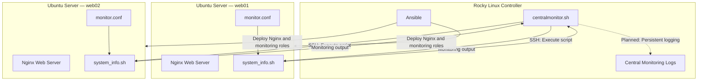
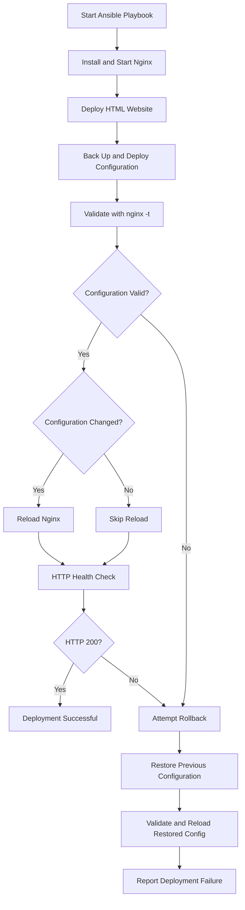

## System Architecture

The Server-Monitor project uses a Rocky Linux controller to manage two Ubuntu servers through Ansible and SSH.



### Components

| Component | Responsibility |
|---|---|
| Rocky Linux | Ansible controller and central monitoring |
| Ansible | Automated deployment and configuration management |
| Nginx | Serves a static HTML website on port 8080 |
| `system_info.sh` | Collects memory, disk, uptime, and service information |
| `monitor.conf` | Stores server-specific disk warning thresholds |
| `centralmonitor.sh` | Executes monitoring scripts remotely over SSH |

## Ansible Automation

The project uses Ansible to automate server configuration and monitoring deployment across two Ubuntu servers from a Rocky Linux controller.

The automation is organized into two reusable roles.

### 1. Nginx Role

**Location:** `ansible/roles/nginx/`

The Nginx role handles web server installation, configuration management, and deployment verification.

### Nginx Deployment Workflow

The Nginx role uses Ansible to automate configuration deployment, validation, and recovery.



**Deployment safeguards:**
- Existing configurations are backed up before replacement.
- Nginx configuration is checked using `nginx -t`.
- Nginx reloads only when the configuration changes.
- HTTP health checks verify basic website availability.
- Ansible attempts rollback when deployment validation or health checks fail.
- Rolling deployment is controlled using `serial: 1`.

**Features:**
- Installs and enables Nginx.
- Creates the web document root and deploys a static HTML page.
- Generates server-specific configurations using Jinja2.
- Creates configuration backups before replacement.
- Validates Nginx configurations using `nginx -t`.
- Reloads Nginx only when its configuration changes.
- Performs HTTP health checks.
- Attempts automatic rollback when deployment validation fails.

The role uses Ansible's `block`, `rescue`, `register`, and `when` features to manage deployment errors.

The rollback mechanism was tested by deliberately introducing an invalid Nginx configuration and verifying that Ansible restored the previous configuration.

### 2. Monitoring Role

**Location:** `ansible/roles/monitoring/`

The monitoring role deploys and configures the existing Bash monitoring scripts on both Ubuntu servers.

**Features:**
- Creates monitoring directories.
- Deploys `system_info.sh`.
- Generates `monitor.conf` from a Jinja2 template.
- Configures disk usage thresholds using per-host variables.
- Maintains the required file permissions.
- Supports repeatable, idempotent deployments.

Once deployed, `centralmonitor.sh` on the Rocky Linux controller connects directly to both Ubuntu servers through SSH and executes their monitoring scripts.

### Deployment

Run the following commands from the `ansible/` directory.

**Deploy the Nginx role:**

```bash
ansible-playbook site.yml -K
```

**Deploy the monitoring role:**

```bash
ansible-playbook monitoring.yml -K
```

**Preview changes on web01:**

```bash
ansible-playbook site.yml --limit web01 --check --diff -K
```

### Testing

The following functionality has been tested in the lab:

| Test | Result |
|---|---|
| Nginx deployment | Passed |
| Nginx configuration validation | Passed |
| Conditional Nginx reload | Passed |
| Idempotency | Passed |
| Nginx configuration rollback | Passed on web01 |
| Monitoring role deployment | Passed on both servers |
| SSH-based central monitoring | Passed |

Both roles use Ansible's declarative configuration management to reduce repetitive manual server administration.

Detailed implementation documentation is available in:

- [Nginx Role README](ansible/roles/nginx/README.md)
- [Monitoring Role README](ansible/roles/monitoring/README.md)
